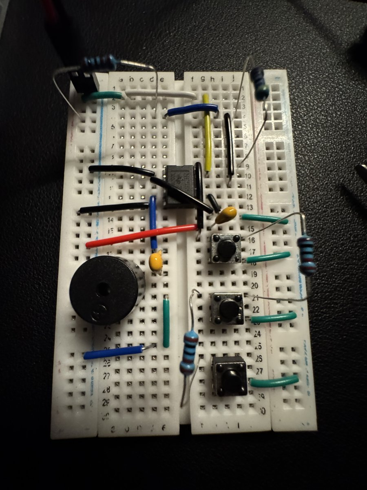

# Project 2: 555 Piano

**Status:** Complete (Nov 3, 2026)
**Spec:** [OPS Project 2](https://ieee.ics.uci.edu/ops-program/project_2.html)

Two circuits built around an NE555P timer running in **astable mode**, where it outputs a continuous square wave:

| Part | What it does | Built on | Completed |
|------|--------------|----------|-----------|
| A. LED Blinker | LED blinks about once per second | Breadboard | Nov 2, 2026 |
| B. 555 Piano | Three buttons, each plays a distinct tone on a passive piezo buzzer | Breadboard | Nov 2, 2026 |
| B. 555 Piano | Same circuit, soldered | Club-provided PCB | Nov 3, 2026 |

Schematics and the PCB were provided by OPS. The PCB was designed by the club in KiCad.

## Demo videos

- [A: LED blinker on breadboard](media/a-led-blinker-breadboard.mp4)
- [B: 555 Piano on breadboard](media/b-piano-breadboard.mp4) (with sound)
- [C: 555 Piano soldered to PCB](media/c-piano-pcb.mp4) (with sound)



*Breadboard build of the piano, before soldering.*

## How the 555 works here

In astable mode, the timing capacitor repeatedly charges through R1 + R2 and discharges through R2 into the **discharge pin (pin 7)**. The output (pin 3) is high while the capacitor charges and low while it discharges.

```
f ≈ 1.44 / ((R1 + 2·R2) · C)
```

- **Blinker:** the resistor and capacitor values set a slow frequency (about 1 Hz), so the blinks are visible.
- **Piano:** each button switches a different resistance into the timing network, which changes the frequency and therefore the pitch. A capacitor in series with the piezo blocks DC so the tone stays clean.

## Learning the circuit from memory

After building the blinker from the schematic, I rebuilt it from memory twice to learn what each pin does:

| Attempt | Time | Result |
|---------|------|--------|
| Rebuild 1 | ~15 min | Forgot the ground connection and miswired the discharge resistor. Checked the schematic to fix both. |
| Rebuild 2 | ~10 min | Built entirely from memory and worked. |

## PCB vs. perfboard

Soldering to the PCB was much easier than the perfboard in Project 1. The traces already make the connections, so the work is just placing and soldering each part. The IC sits in an 8-pin DIP socket, and the battery connects through a header, so neither part is soldered directly.

The soldered piano worked on the first power-up.

## Parts

| Part | Qty |
|------|-----|
| NE555P timer IC + 8-pin DIP socket | 1 |
| Resistors: 1 kΩ ×3, 4.7 kΩ ×1, 470 kΩ ×1 | 5 |
| Ceramic capacitors: 0.1 µF, 1 µF, 10 µF | 3 |
| Tactile switches | 3 |
| Passive piezo buzzer | 1 |
| LED (~2V) | 1 |
| 9V battery + snap connector, female 1x2 headers | — |
| 555 Piano PCB | 1 |
